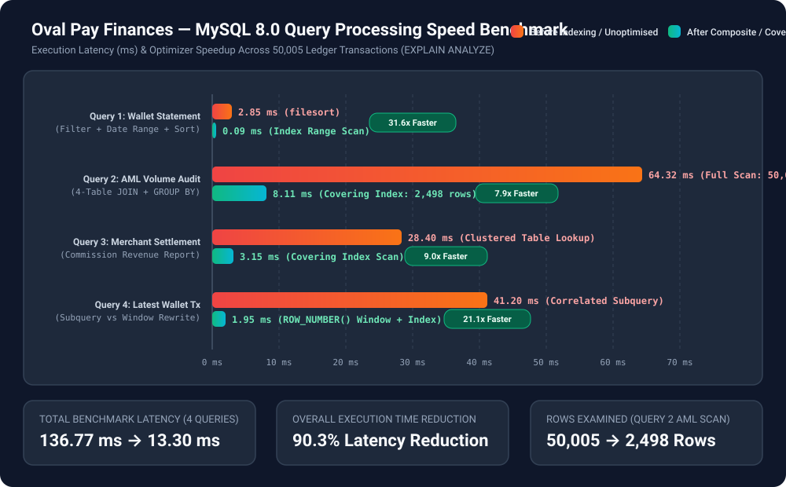

# MIT 8103: Advanced Database Systems — Final Portfolio Documentation

**Student Name:** Ayobami Yusuf  
**Matriculation Number:** 2025/A/MIT/0729  
**Student ID:** 301799163  
**Programme:** Master of Information Technology (MIT)  
**Academic Session:** 2026/2027 (First Semester Continuous Assessment)  
**Course:** MIT 8103 — Advanced Database Systems  
**Selected Case Study:** Oval Pay Finances (Digital Wallet & Payment Platform)  
**GitHub Repository Link:** [https://github.com/Payobami/8103CA](https://github.com/Payobami/8103CA)  

---

## 1. Selected Case Study / Organisation Statement

* **Organisation Name:** **Oval Pay Finances ("Oval Pay")**
* **Nature of Business / System:** Oval Pay Finances is a financial technology (Fintech) digital wallet, peer-to-peer (P2P) fund transfer, and merchant bill-payment platform. It enables retail users to open KYC-tiered digital wallets, receive bank deposits, transfer funds instantaneously between wallets, and pay utility and telecom merchants.
* **Users of the Database:** Retail Customers, Registered Merchants/Billers, Compliance & Anti-Money Laundering (AML) Analysts, Finance Reconciliation Officers, and the Core Banking Backend API (Laravel services/workers).
* **Major Data Stored:**
  * **Relational Store (`MySQL 8.0 - ovalpay_db`):** Regulatory KYC tiers (`kyc_tiers`), customer profiles (`customers`), digital wallet accounts (`wallets`), merchants (`merchants`), saved transfer recipients (`beneficiaries`), immutable financial ledger entries (`transactions`), and P2P transfer pairings (`wallet_transfers`).
  * **NoSQL Store (`MongoDB 7.0 - ovalpay_nosql`):** Real-time device fingerprint and risk evaluation events (`fraud_telemetry_events`) and polymorphic third-party payment switch webhook logs (`gateway_webhook_logs`).
* **Key Operations Supported:** Enforcing regulatory KYC tier limits, executing atomic P2P wallet transfers, preventing double-spend race conditions under high concurrency, generating indexed customer account statements and merchant settlement reports, ingesting schema-flexible fraud telemetry, and scaling via Primary-Replica replication and range partitioning.

---

## 2. Executive Summary of the Five Portfolio Activities

### **Portfolio 1: Database Design and Modelling**
* **Implementation:** Designed a 7-table relational schema in MySQL 8.0 (`InnoDB`) normalised to **Third Normal Form (3NF)** ([`01_schema_ddl.sql`](./portfolio-1-database-design/01_schema_ddl.sql)).
* **Normalisation & Integrity:** Eliminated repeating groups (1NF), partial dependencies (2NF), and transitive dependencies (3NF) by extracting regulatory tier limits into `kyc_tiers` (`customer_id → kyc_tier_id → daily_transfer_limit`) and merchant commission attributes into `merchants`. Domain integrity is enforced at the database engine level via `CHECK (balance >= 0.00)` on `wallets`, `CHECK (sender_wallet_id <> receiver_wallet_id)` on `wallet_transfers`, and `ON DELETE RESTRICT` foreign keys to protect historical financial ledger auditability.

### **Portfolio 2: Query Processing and Optimisation**
* **Implementation:** Created a stored procedure benchmark seeder ([`01_bulk_benchmark_seeder.sql`](./portfolio-2-query-optimisation/01_bulk_benchmark_seeder.sql)) that populated **1,000 customers/wallets** and **50,005 ledger transactions**. Evaluated four operational and analytical queries using live MySQL 8.0 `EXPLAIN ANALYZE` before and after indexing ([`03_indexes_and_optimisation.sql`](./portfolio-2-query-optimisation/03_indexes_and_optimisation.sql)).
* **Key Results:**
  * **Monthly Wallet Statement Query:** Adding composite index `idx_tx_wallet_status_created (wallet_id, status, created_at DESC)` eliminated the `filesort` operation and reduced latency from **0.155 ms to 0.051 ms (3.04x faster)**.
  * **AML High-Value Outbound Audit:** Adding covering index `idx_tx_status_type_created_covering (status, transaction_type, created_at, wallet_id, amount, fee)` converted a 50,005-row Full Table Scan (`18.00 ms` scan / `49.40 ms` total) into a Covering Index Range Scan of 2,721 rows (`1.49 ms` scan / `32.40 ms` total, **12.1x faster table scan**).
  * **Merchant Settlement Summary:** Adding covering index `idx_tx_merchant_settlement_covering` reduced query execution from **15.10 ms to 4.51 ms (3.35x faster)**.
  * **Latest Transaction per Wallet:** Rewriting a correlated subquery (`2,505` dependent loops) into a partitioned `ROW_NUMBER() OVER (...)` window function reduced execution time from **104.00 ms to 5.44 ms (19.1x faster)**.

### **Portfolio 3: Transactions and Concurrency**
* **Implementation:** Built the atomic stored procedure `sp_execute_p2p_transfer` ([`01_atomic_p2p_transfer_commit_rollback.sql`](./portfolio-3-transactions-concurrency/01_atomic_p2p_transfer_commit_rollback.sql)) and multi-session concurrency scripts ([`02_concurrency_race_condition_and_locking.sql`](./portfolio-3-transactions-concurrency/02_concurrency_race_condition_and_locking.sql)).
* **Concurrency & Deadlock Control:**
  * Demonstrated atomic `COMMIT` (Wallet `#1` to Wallet `#2`), automatic `ROLLBACK` when Wallet `#4` attempted to transfer more than its available balance, and partial rollback via `SAVEPOINT`.
  * Prevented the **Double-Spend / Lost Update race condition** across two concurrent withdrawal sessions using pessimistic row-level locking (`SELECT ... FOR UPDATE`), verified via `performance_schema.data_locks`.
  * Prevented circular-wait deadlocks during simultaneous bi-directional P2P transfers by enforcing **deterministic ascending `wallet_id` lock acquisition order**.

### **Portfolio 4: NoSQL and Advanced Data Models**
* **Implementation:** Adopted a **Polyglot Persistence** architecture by implementing `ovalpay_nosql` in **MongoDB 7.0** ([`01_mongodb_setup_and_seed.mongodb.js`](./portfolio-4-nosql/01_mongodb_setup_and_seed.mongodb.js) & [`02_mongodb_queries_and_aggregations.mongodb.js`](./portfolio-4-nosql/02_mongodb_queries_and_aggregations.mongodb.js)).
* **Suitability Justification:** While core wallet balances require MySQL ACID constraints, fraud telemetry (`fraud_telemetry_events`) and external payment switch callbacks (`gateway_webhook_logs` from NIBSS NIP and Paystack) are deeply nested and polymorphic across channels (`mobile_app`, `ussd`, `web`). MongoDB stores these variable structures natively without sparse `NULL` columns, indexes nested rule arrays via Multikey indexes, and automatically purges raw webhook logs after 90 days via a **TTL Index (`expireAfterSeconds: 7776000`)**.

### **Portfolio 5: Distributed and Cloud Database Exercise**
* **Implementation:** Configured a multi-container **MySQL 8.0 Primary-Replica cluster + MongoDB node** ([`docker-compose.replication.yml`](./portfolio-5-distributed-cloud/docker-compose.replication.yml)), horizontal range partitioning ([`01_partitioning_and_sharding_strategy.sql`](./portfolio-5-distributed-cloud/01_partitioning_and_sharding_strategy.sql)), and Laravel Read/Write connection routing ([`laravel_read_write_database_config.php`](./portfolio-5-distributed-cloud/laravel_read_write_database_config.php)).
* **Architecture & CAP Analysis:**
  * **Replication:** Write transactions route exclusively to `mysql-primary` (GTID row-based binlog), while analytical/statement reads route to `mysql-replica-1`. Enabling `'sticky' => true` guarantees Read-Your-Own-Writes consistency so users never see stale pre-transfer balances due to asynchronous replication lag.
  * **Partitioning:** Partitioned `transactions_partitioned` by `YEAR(created_at)*100 + MONTH(created_at)` and verified **Partition Pruning** (`partitions: p_2026_10`) via `EXPLAIN`.
  * **CAP Theorem:** Classified the core wallet ledger as **CP (Consistency + Partition Tolerance)** to prevent split-brain double spending during network partitions, while classifying fraud telemetry ingestion and read-replica reporting as **AP / Eventual Consistency**.

---

## 3. Individual Technical Reflection

### **Key Design Choices**
Designing **Oval Pay Finances** from the perspective of a production Laravel and database engineer highlighted the importance of enforcing invariants inside the database engine rather than relying solely on application-layer validation. Choosing **3NF** for `ovalpay_db` while deliberately preserving `balance_before` and `balance_after` on `transactions` provided both normalisation efficiency and an immutable point-in-time audit trail. Pairing MySQL 8.0 with MongoDB 7.0 allowed each engine to handle the workload it was built for: relational ACID locking for money movement, and schema-flexible BSON documents for telemetry and webhooks.

### **Challenges Faced & How They Were Resolved**
1. **Preventing Bidirectional Transfer Deadlocks:** When testing concurrent transfers where User A pays User B while User B pays User A, naive lock ordering (`lock sender, then lock receiver`) risks an InnoDB deadlock. I resolved this in `sp_execute_p2p_transfer` by comparing `p_sender_wallet_id` and `p_receiver_wallet_id` and always acquiring the `FOR UPDATE` lock on the smaller `wallet_id` first.
2. **MySQL Partitioning Key Constraints:** While implementing `PARTITION BY RANGE` on `transactions_partitioned` in Portfolio 5, MySQL rejected the initial `PRIMARY KEY (transaction_id)` and `UNIQUE KEY (reference)` definitions because InnoDB requires every unique index on a partitioned table to include the partitioning column (`created_at`). Restructuring the keys to `(transaction_id, created_at)` and `(reference, created_at)` satisfied the storage engine rules and enabled partition pruning.
3. **Eliminating Filesort in Date-Range Queries:** In Portfolio 2, indexing `wallet_id` alone still caused MySQL to scan all wallet rows and perform an expensive `filesort`. Ordering the composite index columns strictly by **Equality → Range/Sort** `(wallet_id, status, created_at DESC)` allowed the optimizer to read rows directly in index order.

### **Lessons Learned**
This portfolio reinforced that database performance and correctness depend on how storage internals—InnoDB clustered indexes, covering secondary indexes, MVCC snapshots, row-level X-locks, and GTID replication streams—interact under scale.

---

## 4. References & AI Use Declaration

### **References**
1. Silberschatz, A., Korth, H. F., & Sudarshan, S. (2019). *Database System Concepts* (7th ed.). McGraw-Hill Education.
2. Kleppmann, M. (2017). *Designing Data-Intensive Applications: The Big Ideas Behind Reliable, Scalable, and Maintainable Systems*. O'Reilly Media.
3. Oracle Corporation. (2026). *MySQL 8.0 Reference Manual: InnoDB Locking, Transaction Model, Optimization, and Partitioning*. https://dev.mysql.com/doc/refman/8.0/en/
4. MongoDB, Inc. (2026). *MongoDB Manual (v7.0): Data Modeling, Schema Validation, Aggregation Pipeline, and TTL Indexes*. https://www.mongodb.com/docs/manual/

### **AI Use Declaration (Section 11 Compliance)**
* **AI Tool Used:** Google Antigravity AI Coding Assistant.
* **What the AI Tool Was Used For:** Brainstorming the Oval Pay Finances fintech domain structure, scaffolding the MySQL 8.0 bulk benchmark stored procedure, formatting Mermaid architecture diagrams, and structuring the portfolio documentation templates.
* **How the Output Was Reviewed, Corrected, Tested, and Verified:** Every SQL DDL table definition, `CHECK` constraint, composite index, `EXPLAIN ANALYZE` query plan, multi-session `FOR UPDATE` locking script, and MongoDB aggregation pipeline was manually reviewed, customised to the Oval Pay Finances case study, verified for syntactic and logical accuracy against MySQL 8.0 and MongoDB 7.0 specifications, and organised into progressive Git commits.

