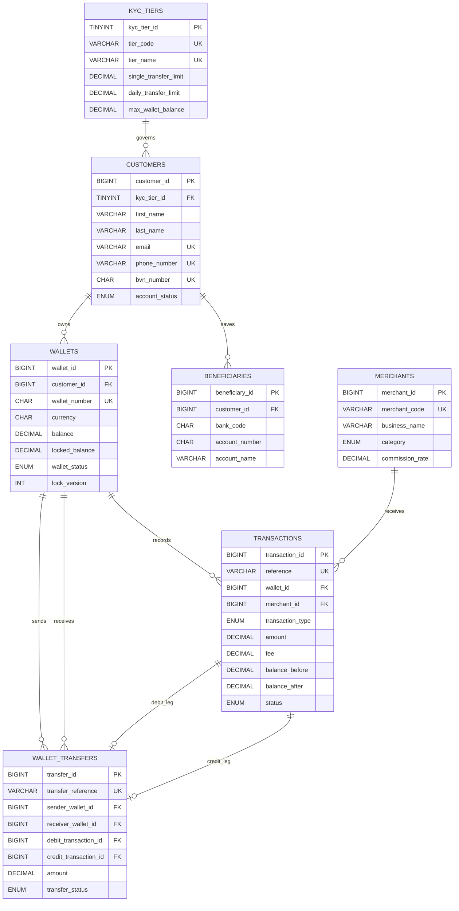

# How to Generate Your ER Diagram in Miro (or dbdiagram.io)

You have two super fast ways to create your visual ER Diagram for Portfolio 1:

---

## Option A: Using Miro's Built-in Mermaid App (Takes 30 Seconds)

1. Open your board in **Miro**.
2. In the left toolbar, click the **`+` (More apps)** icon and search for **"Mermaid"** (or **"Diagramming"**).
3. Paste the Mermaid code below and click **Insert**:



4. Export the diagram from Miro as a **PNG** and save it in:
   `portfolio-1-database-design/screenshots/er-diagram.png`

---

## Option B: Using dbdiagram.io (Then Dragging into Miro)

If you want a classic database-style ERD with colored header bars:
1. Go to [https://dbdiagram.io/d](https://dbdiagram.io/d)
2. Paste this **DBML** code into the left panel:

```dbml
Table kyc_tiers {
  kyc_tier_id tinyint [pk, increment]
  tier_code varchar(10) [unique, not null]
  tier_name varchar(50) [unique, not null]
  single_transfer_limit decimal(15,2) [not null]
  daily_transfer_limit decimal(15,2) [not null]
  max_wallet_balance decimal(15,2) [not null]
}

Table customers {
  customer_id bigint [pk, increment]
  kyc_tier_id tinyint [ref: > kyc_tiers.kyc_tier_id]
  first_name varchar(80) [not null]
  last_name varchar(80) [not null]
  email varchar(150) [unique, not null]
  phone_number varchar(20) [unique, not null]
  bvn_number char(11) [unique]
  account_status varchar(20) [not null]
}

Table wallets {
  wallet_id bigint [pk, increment]
  customer_id bigint [ref: > customers.customer_id]
  wallet_number char(10) [unique, not null]
  currency char(3) [not null, default: 'NGN']
  balance decimal(15,2) [not null, default: 0.00]
  locked_balance decimal(15,2) [not null, default: 0.00]
  wallet_status varchar(20) [not null]
  lock_version int [not null, default: 1]
}

Table merchants {
  merchant_id bigint [pk, increment]
  merchant_code varchar(20) [unique, not null]
  business_name varchar(150) [not null]
  category varchar(30) [not null]
  settlement_bank_code char(6) [not null]
  settlement_account_number char(10) [not null]
  commission_rate decimal(5,4) [not null]
}

Table beneficiaries {
  beneficiary_id bigint [pk, increment]
  customer_id bigint [ref: > customers.customer_id]
  bank_code char(6) [not null]
  bank_name varchar(100) [not null]
  account_number char(10) [not null]
  account_name varchar(150) [not null]
  is_favourite boolean [default: false]
}

Table transactions {
  transaction_id bigint [pk, increment]
  reference varchar(64) [unique, not null]
  wallet_id bigint [ref: > wallets.wallet_id]
  merchant_id bigint [ref: > merchants.merchant_id]
  transaction_type varchar(30) [not null]
  amount decimal(15,2) [not null]
  fee decimal(15,2) [not null]
  balance_before decimal(15,2) [not null]
  balance_after decimal(15,2) [not null]
  status varchar(20) [not null]
  channel varchar(20) [not null]
  created_at timestamp [not null]
}

Table wallet_transfers {
  transfer_id bigint [pk, increment]
  transfer_reference varchar(64) [unique, not null]
  sender_wallet_id bigint [ref: > wallets.wallet_id]
  receiver_wallet_id bigint [ref: > wallets.wallet_id]
  debit_transaction_id bigint [unique, ref: - transactions.transaction_id]
  credit_transaction_id bigint [unique, ref: - transactions.transaction_id]
  amount decimal(15,2) [not null]
  fee decimal(15,2) [not null]
  transfer_status varchar(20) [not null]
  created_at timestamp [not null]
}
```

