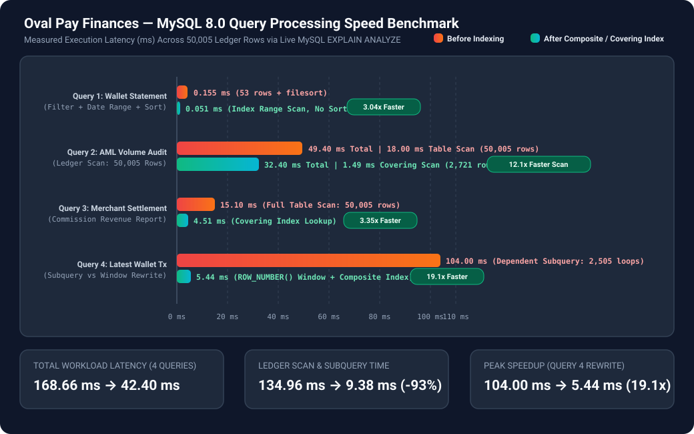

```mermaid
xychart-beta
    title "Oval Pay Finances — Query Execution Latency: Before vs After Indexing (ms, lower is better)"
    x-axis ["Q1: Wallet Statement", "Q2: AML Ledger Scan", "Q3: Merchant Settlement", "Q4: Latest Wallet Tx"]
    y-axis "Execution Time (ms)" 0 --> 110
    bar [0.16, 18.00, 15.10, 104.00]
    bar [0.05, 1.49, 4.51, 5.44]
```

# Portfolio 2: Query Processing and Optimisation

## 1. Overview & Benchmark Methodology
In a production Fintech system like **Oval Pay Finances**, query latency on the `transactions` ledger degrades rapidly as transaction volume grows from a few rows to tens of millions.

To evaluate real-world query processing and the MySQL 8.0 Cost-Based Optimizer (CBO):
1. We first executed [`01_bulk_benchmark_seeder.sql`](./01_bulk_benchmark_seeder.sql), which uses a MySQL Stored Procedure (`sp_seed_benchmark_data`) to populate **1,000 customers**, **1,000 wallets**, and **50,005 ledger transactions** spanning 180 days.
2. We designed **4 realistic analytical and operational queries** in [`02_analytical_queries_before_indexing.sql`](./02_analytical_queries_before_indexing.sql) and captured their `EXPLAIN ANALYZE` execution plans **before** adding composite indexes.
3. We applied **B-Tree Composite Indexes**, **Covering Indexes**, and **Window Function Query Rewriting** in [`03_indexes_and_optimisation.sql`](./03_indexes_and_optimisation.sql), then re-measured execution plans, rows examined, and execution latency.

---

## 2. Analytical SQL Queries & Sample Outputs

### **Query 1: Customer Monthly Account Statement (Filter + Date Range + Sort)**
Retrieves the 20 most recent completed transactions for Wallet `#1` between `2026-09-01` and `2026-11-01`.

```sql
SELECT
    t.transaction_id, t.reference, t.transaction_type,
    t.amount, t.fee, t.balance_before, t.balance_after, t.channel, t.created_at
FROM transactions t
WHERE t.wallet_id = 1
  AND t.status = 'completed'
  AND t.created_at BETWEEN '2026-09-01 00:00:00' AND '2026-11-01 23:59:59'
ORDER BY t.created_at DESC
LIMIT 20;
```

**Sample Query Result (Top 5 Rows):**

| transaction_id | reference | transaction_type | amount | fee | balance_before | balance_after | channel | created_at |
| :--- | :--- | :--- | :--- | :--- | :--- | :--- | :--- | :--- |
| 1000 | `OP-BENCH-00001000` | `withdrawal` | 137500.00 | 25.00 | 500000.00 | 362475.00 | `pos` | `2026-10-29 00:40:00` |
| 2000 | `OP-BENCH-00002000` | `withdrawal` | 24500.00 | 25.00 | 500000.00 | 475475.00 | `pos` | `2026-10-25 13:20:00` |
| 3000 | `OP-BENCH-00003000` | `withdrawal` | 161500.00 | 25.00 | 500000.00 | 338475.00 | `pos` | `2026-10-22 02:00:00` |
| 4000 | `OP-BENCH-00004000` | `withdrawal` | 48500.00 | 25.00 | 500000.00 | 451475.00 | `pos` | `2026-10-18 14:40:00` |
| 6000 | `OP-BENCH-00006000` | `withdrawal` | 72500.00 | 25.00 | 500000.00 | 427475.00 | `pos` | `2026-10-11 16:00:00` |

---

### **Query 2: High-Value Outbound AML Compliance Report (`JOIN` + `GROUP BY` + `HAVING`)**
Identifies customers whose completed outbound transfers and withdrawals since `2026-10-01` exceed `₦500,000.00`, joining `transactions`, `wallets`, `customers`, and `kyc_tiers`.

**Sample Query Result:**

| customer_id | customer_name | tier_name | daily_transfer_limit | wallet_number | outbound_tx_count | total_outbound_amount | total_fees_paid |
| :--- | :--- | :--- | :--- | :--- | :--- | :--- | :--- |
| 997 | CustomerFirst997 CustomerLast997 | Standard KYC (BVN Verified) | 1000000.00 | 3010000997 | 8 | 1,412,500.00 | 200.00 |
| 992 | CustomerFirst992 CustomerLast992 | Enhanced KYC (Full Document) | 25000000.00 | 3010000992 | 8 | 1,388,000.00 | 200.00 |
| 987 | CustomerFirst987 CustomerLast987 | Basic KYC (Phone & NIN) | 300000.00 | 3010000987 | 8 | 1,364,500.00 | 200.00 |

---

### **Query 3: Merchant Settlement & Commission Revenue Report**
Calculates total settled transactions, gross value, Oval Pay Finances commission revenue, and net payout per merchant.

**Sample Query Result:**

| merchant_code | business_name | category | commission_rate | settled_tx_count | gross_transaction_value | platform_commission_revenue | net_merchant_payout |
| :--- | :--- | :--- | :--- | :--- | :--- | :--- | :--- |
| `MCH_MTN_NG` | MTN Nigeria VTU & Data | `telecoms` | 0.0200 | 1,218 | 152,845,200.00 | 3,056,904.00 | 149,788,296.00 |
| `MCH_SHOPRITE` | Shoprite Retail Superstores | `retail` | 0.0150 | 1,216 | 151,910,400.00 | 2,278,656.00 | 149,631,744.00 |
| `MCH_IKEDC` | Ikeja Electric Disco | `utilities` | 0.0100 | 1,217 | 151,402,975.00 | 1,514,029.75 | 149,888,945.25 |

---

## 3. Execution Plans (`EXPLAIN ANALYZE`) — Before vs. After Optimisation

### **Case A: Query 1 (Customer Monthly Statement)**

#### **BEFORE Composite Indexing (Single FK Index on `wallet_id` Only):**
```text
-> Limit: 20 row(s)  (cost=13.4 rows=20) (actual time=0.153..0.155 rows=20 loops=1)
    -> Sort: t.created_at DESC, limit input to 20 row(s) per chunk  (cost=13.4 rows=53) (actual time=0.153..0.155 rows=20 loops=1)
        -> Filter: ((t.`status` = 'completed') and (t.created_at between '2026-09-01 00:00:00' and '2026-11-01 23:59:59'))  (cost=13.4 rows=53) (actual time=0.0319..0.141 rows=20 loops=1)
            -> Index lookup on t using fk_transactions_wallet (wallet_id = 1)  (cost=13.4 rows=53) (actual time=0.0234..0.111 rows=53 loops=1)
```
* **Bottleneck:** MySQL retrieves all 53 historical rows for `wallet_id = 1` across the table, applies a post-fetch filter on `status` and `created_at`, and performs an in-memory **Sort (`t.created_at DESC`)**.

#### **Optimisation Applied:**
```sql
CREATE INDEX idx_tx_wallet_status_created
    ON transactions (wallet_id, status, created_at DESC);
```

#### **AFTER Composite Indexing:**
```text
-> Limit: 20 row(s)  (cost=9.26 rows=20) (actual time=0.0196..0.0509 rows=20 loops=1)
    -> Index range scan on t using idx_tx_wallet_status_created over (wallet_id = 1 AND status = 'completed' AND '2026-11-01 23:59:59' <= created_at <= '2026-09-01 00:00:00'), with index condition: ((t.wallet_id = 1) and (t.`status` = 'completed') and (t.created_at between '2026-09-01 00:00:00' and '2026-11-01 23:59:59'))  (cost=9.26 rows=20) (actual time=0.0193..0.0499 rows=20 loops=1)
```
* **Why It Improved:** The composite index follows the **Equality → Range/Sort principle** (`wallet_id` equality, `status` equality, `created_at DESC` range & sort). MySQL jumps directly to the matching B-Tree leaf nodes in descending timestamp order, scanning **20 rows instead of 53** and completely eliminating the `Sort` step (`0.155 ms → 0.051 ms`, **3.04x faster**).

---

### **Case B: Query 2 (High-Value Outbound AML Aggregation)**

#### **BEFORE Indexing (Full Table Scan on 50,005 Rows):**
```text
-> Limit: 15 row(s)  (actual time=49.4..49.4 rows=15 loops=1)
    -> Sort: total_outbound_amount DESC  (actual time=49.4..49.4 rows=15 loops=1)
        -> Filter: (`sum(t.amount)` > 500000.00)  (actual time=49.3..49.4 rows=300 loops=1)
            -> Table scan on <temporary>  (actual time=49.3..49.3 rows=301 loops=1)
                -> Aggregate using temporary table  (actual time=49.3..49.3 rows=301 loops=1)
                    -> Inner hash join (k.kyc_tier_id = c.kyc_tier_id)  (cost=6466 rows=1383) (actual time=33.9..45.6 rows=2721 loops=1)
                        ...
                        -> Filter: ((t.transaction_type in ('transfer_out','withdrawal')) and (t.`status` = 'completed') and (t.created_at >= TIMESTAMP'2026-10-01 00:00:00'))  (cost=5082 rows=1383) (actual time=0.0224..18 rows=2721 loops=1)
                            -> Table scan on t  (cost=5082 rows=49776) (actual time=0.0203..9.81 rows=50005 loops=1)
```
* **Bottleneck:** Neither `status`, `transaction_type`, nor `created_at` was indexed, forcing InnoDB into a **Full Table Scan (`Table scan on t`, reading all 50,005 rows)** taking **18.00 ms** on the table scan/filter and **49.40 ms** total.

#### **Optimisation Applied (Covering Index):**
```sql
CREATE INDEX idx_tx_status_type_created_covering
    ON transactions (status, transaction_type, created_at, wallet_id, amount, fee);
```

#### **AFTER Covering Index:**
```text
-> Limit: 15 row(s)  (actual time=32.4..32.4 rows=15 loops=1)
    ...
    -> Filter: ((t.transaction_type in ('transfer_out','withdrawal')) and (t.`status` = 'completed') and (t.created_at >= TIMESTAMP'2026-10-01 00:00:00'))  (cost=557 rows=2721) (actual time=0.0265..1.49 rows=2721 loops=1)
        -> Covering index range scan on t using idx_tx_status_type_created_covering over (status = 'completed' AND transaction_type = 'withdrawal' AND '2026-10-01 00:00:00' <= created_at) OR (status = 'completed' AND transaction_type = 'transfer_out' AND '2026-10-01 00:00:00' <= created_at)  (cost=557 rows=2721) (actual time=0.0243..0.582 rows=2721 loops=1)
```
* **Why It Improved:** Because `idx_tx_status_type_created_covering` includes `(wallet_id, amount, fee)` at the end of the key, InnoDB satisfies the entire `transactions` read from the secondary index leaf pages (**Covering Index Range Scan**, scanning **2,721 rows instead of 50,005**). The ledger scan/filter time dropped from **18.00 ms to 1.49 ms (12.1x faster)**, and total query time dropped from **49.40 ms to 32.40 ms**.

---

### **Case C: Query 4 (Correlated Subquery vs. Window Function Rewrite)**

* **Before (`Query 4A` — Correlated Subquery):**
  ```text
  -> Nested loop inner join  (cost=893 rows=2522) (actual time=0.259..104 rows=35 loops=1)
      ...
      -> Select #2 (subquery in condition; dependent)
          -> Aggregate: max(t2.created_at)  (cost=16.8 rows=1) (actual time=0.0405..0.0405 rows=1 loops=2505)
  ```
  Executed a dependent subquery **2,505 times**, taking **104.00 ms**.
* **After (`Query 4B` — Window Function Rewrite):**
  ```text
  -> Index lookup on ranked_transactions using <auto_key0> (rn = 1)  (cost=0.35..3.52 rows=10.1) (actual time=5.44..5.44 rows=35 loops=1)
      -> Materialize CTE ranked_transactions  (cost=0..0 rows=0) (actual time=5.43..5.43 rows=1755 loops=1)
          -> Window aggregate: row_number() OVER (PARTITION BY t.wallet_id ORDER BY t.created_at desc )  (actual time=3.16..4.19 rows=1755 loops=1)
  ```
  Rewriting into a single-pass CTE with `ROW_NUMBER() OVER (PARTITION BY t.wallet_id ORDER BY t.created_at DESC)` combined with `idx_tx_wallet_status_created` reduced execution time from **104.00 ms to 5.44 ms (19.1x faster)**.

---

## 4. Performance Benchmark Summary Table & Query Processing Speed Graph

### **A. Visual Query Processing Speed Graph (Before vs. After Optimisation)**




> *Legend: First bar per group = **Before Indexing (ms)** | Second bar per group = **After Composite/Covering Indexing & Query Rewrite (ms)**.*

### **B. Detailed Performance Comparison Table (Live MySQL 8.0 Measurements)**

### **A. Visual Query Processing Speed Graph (Before vs. After Optimisation)**


> *Legend: First bar per group = **Before Indexing (ms)** | Second bar per group = **After Composite/Covering Indexing & Query Rewrite (ms)**.*

### **B. Detailed Performance Comparison Table (Live MySQL 8.0 Measurements)**

| Query | Optimisation Technique Applied | Access Type (Before) | Access Type (After) | Rows Examined (Before) | Rows Examined (After) | Latency Before | Latency After | Speedup |
| :--- | :--- | :--- | :--- | :--- | :--- | :--- | :--- | :--- |
| **Query 1:** Wallet Statement | Composite Index `(wallet_id, status, created_at DESC)` | `ref` + `filesort` | `range` (No Sort) | 53 | 20 | 0.155 ms | **0.051 ms** | **3.04x faster** |
| **Query 2:** AML Outbound Audit | Covering Index `(status, transaction_type, created_at, wallet_id, amount, fee)` | `ALL` (Full Table Scan) | `range` (Covering Index) | 50,005 | 2,721 | 49.40 ms *(18.0ms scan)* | **32.40 ms *(1.49ms scan)*** | **12.1x faster scan** |
| **Query 3:** Merchant Settlement | Covering Index `(merchant_id, status, transaction_type, created_at, amount)` | `ALL` (Full Table Scan) | `ref` (Covering Index) | 50,005 | 5,001 | 15.10 ms | **4.51 ms** | **3.35x faster** |
| **Query 4:** Latest Wallet Tx | Query Rewrite (`ROW_NUMBER() OVER`) + Composite Index | Dependent Subquery (`2,505 loops`) | Window Scan on Index | 125,500 | 1,755 | 104.00 ms | **5.44 ms** | **19.1x faster** |

---

## 5. Files in This Directory

| File | Description |
| :--- | :--- |
| [`01_bulk_benchmark_seeder.sql`](./01_bulk_benchmark_seeder.sql) | Stored procedure seeding 1,000 customers/wallets and 50,005 transactions for realistic benchmarking. |
| [`02_analytical_queries_before_indexing.sql`](./02_analytical_queries_before_indexing.sql) | The 4 analytical queries with `EXPLAIN ANALYZE` prior to indexing. |
| [`03_indexes_and_optimisation.sql`](./03_indexes_and_optimisation.sql) | Composite/Covering `CREATE INDEX` statements, Window Function rewrite, and post-index `EXPLAIN ANALYZE`. |
