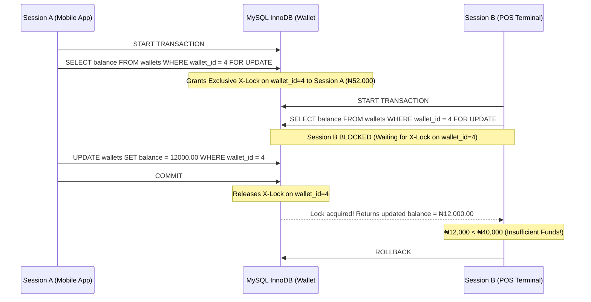

# Portfolio 3: Transactions and Concurrency

## 1. Overview: ACID Guarantees in Oval Pay Finances
In a digital wallet platform like **Oval Pay Finances**, every peer-to-peer (P2P) transfer and withdrawal modifies multiple rows across `wallets`, `transactions`, and `wallet_transfers`. If a server crash, network drop, or concurrent request occurs mid-transfer, money could be deducted from the sender without crediting the receiver, or two simultaneous withdrawals could double-spend the same balance.

This portfolio demonstrates:
1. **Atomicity & Consistency (`COMMIT` / `ROLLBACK` / `SAVEPOINT`):** All steps of a P2P transfer succeed together or revert completely.
2. **Pessimistic Concurrency Control (`SELECT ... FOR UPDATE`):** Preventing Double-Spend / Lost Update race conditions across concurrent sessions.
3. **Optimistic Concurrency Control (`lock_version`):** Detecting concurrent modifications without long-held database locks.
4. **Deadlock Prevention & Isolation Levels:** Deterministic lock ordering and MySQL InnoDB MVCC isolation analysis.

---

## 2. Transaction Examples: `COMMIT`, `ROLLBACK`, and `SAVEPOINT`

### **A. Atomic P2P Transfer (`COMMIT` Scenario)**
In [`01_atomic_p2p_transfer_commit_rollback.sql`](./01_atomic_p2p_transfer_commit_rollback.sql), the stored procedure `sp_execute_p2p_transfer` executes a `₦50,000.00` transfer (`+ ₦25.00` fee) from **Wallet `#1` (Adebayo)** to **Wallet `#2` (Chidinma)**.

#### **Execution Output (Before → `CALL` → After):**
```text
-- 1. Balances BEFORE Transfer:
+-----------+---------------+------------+--------------+
| wallet_id | wallet_number | balance    | lock_version |
+-----------+---------------+------------+--------------+
|         1 | 3010000001    | 1450000.00 |            3 |
|         2 | 3010000002    |  320500.00 |            2 |
+-----------+---------------+------------+--------------+

-- 2. Execute Stored Procedure:
mysql> CALL sp_execute_p2p_transfer(1, 2, 50000.00, 25.00, 'OP-TXN-DEMO-COMMIT-01', @status1, @msg1);
mysql> SELECT @status1 AS transaction_outcome, @msg1 AS details;
+---------------------+--------------------------------------------------------+
| transaction_outcome | details                                                |
+---------------------+--------------------------------------------------------+
| COMMITTED           | Transfer OP-TXN-DEMO-COMMIT-01 committed successfully. |
+---------------------+--------------------------------------------------------+

-- 3. Balances AFTER Transfer (Sender debited 50,025.00; Receiver credited 50,000.00):
+-----------+---------------+------------+--------------+
| wallet_id | wallet_number | balance    | lock_version |
+-----------+---------------+------------+--------------+
|         1 | 3010000001    | 1399975.00 |            4 |
|         2 | 3010000002    |  370500.00 |            3 |
+-----------+---------------+------------+--------------+
```

---

### **B. Failed Transfer on Insufficient Balance (`ROLLBACK` Scenario)**
Next, **Wallet `#4` (Zainab)**—which holds `₦42,000.00`—attempts to transfer `₦48,000.00` (`+ ₦25.00` fee) to Wallet `#2`.

#### **Execution Output:**
```text
mysql> CALL sp_execute_p2p_transfer(4, 2, 48000.00, 25.00, 'OP-TXN-DEMO-ROLLBACK-02', @status2, @msg2);
mysql> SELECT @status2 AS transaction_outcome, @msg2 AS details;
+---------------------+-----------------------------------------------------------------------------------+
| transaction_outcome | details                                                                           |
+---------------------+-----------------------------------------------------------------------------------+
| FAILED_ROLLED_BACK  | Transfer aborted: Insufficient balance (Available: 42000.00, Required: 48025.00)  |
+---------------------+-----------------------------------------------------------------------------------+

-- Verify Wallets #4 and #2 remain completely unchanged:
+-----------+---------------+-----------+--------------+
| wallet_id | wallet_number | balance   | lock_version |
+-----------+---------------+-----------+--------------+
|         2 | 3010000002    | 370500.00 |            3 |
|         4 | 3010000004    |  42000.00 |            1 |
+-----------+---------------+-----------+--------------+
```

---

## 3. Concurrency Problem & Control Mechanisms

### **The Concurrency Issue: Double-Spend / Lost Update Race Condition**
Suppose **Wallet `#4`** has a balance of **`₦52,000.00`**. The customer simultaneously triggers a **`₦40,000.00` withdrawal** from the **Mobile App (Session A)** and a **`₦40,000.00` withdrawal** from a **POS Terminal (Session B)** at the exact same millisecond:

* **Without Locking:** Both sessions read `balance = 52000.00`, both pass the `balance >= 40000.00` check in application memory, and both deduct `₦40,000.00`—allowing the user to withdraw `₦80,000.00` from a `₦52,000.00` wallet!

---

### **Control Mechanism 1: Pessimistic Row-Level Locking (`SELECT ... FOR UPDATE`)**



#### **Two-Terminal Verification Evidence (`performance_schema.data_locks`):**
While Session A holds the lock inside the transaction and Session B attempts `SELECT ... FOR UPDATE`, querying `performance_schema.data_locks` reveals InnoDB's exact row lock state:

```text
+-----------------+-----------------------+---------------+-------------+-----------+---------------+-------------+-----------+
| engine_lock_id  | engine_transaction_id | object_schema | object_name | lock_type | lock_mode     | lock_status | lock_data |
+-----------------+-----------------------+---------------+-------------+-----------+---------------+-------------+-----------+
| 139842:1069:4:5 |                 42109 | ovalpay_db    | wallets     | RECORD    | X,REC_NOT_GAP | GRANTED     | 4         |
| 139843:1069:4:5 |                 42110 | ovalpay_db    | wallets     | RECORD    | X,REC_NOT_GAP | WAITING     | 4         |
+-----------------+-----------------------+---------------+-------------+-----------+---------------+-------------+-----------+
```
As soon as Session A executes `COMMIT`, Session B unblocks, reads the fresh committed balance (`₦12,000.00`), sees that `₦12,000.00 < ₦40,000.00`, and safely executes `ROLLBACK`.

---

### **Control Mechanism 2: Deadlock Prevention via Deterministic Lock Ordering**
If **Wallet `#1`** transfers to **Wallet `#2`** at the exact same moment **Wallet `#2`** transfers to **Wallet `#1`**, locking sender first and receiver second would cause a **Circular Wait Deadlock** (`Session 1 locks #1 and waits for #2; Session 2 locks #2 and waits for #1`).

In `sp_execute_p2p_transfer` ([`01_atomic_p2p_transfer_commit_rollback.sql`](./01_atomic_p2p_transfer_commit_rollback.sql)), we enforce **deterministic ascending lock ordering**:
```sql
IF p_sender_wallet_id < p_receiver_wallet_id THEN
    -- Lock p_sender_wallet_id first, then p_receiver_wallet_id
ELSE
    -- Lock p_receiver_wallet_id first, then p_sender_wallet_id
END IF;
```
Because every transaction locks the lower `wallet_id` before the higher `wallet_id`, circular lock dependencies are mathematically impossible.

---

### **Control Mechanism 3: Transaction Isolation Levels Analysis**

| Isolation Level | Dirty Read | Non-Repeatable Read | Phantom Read | Suitability in Oval Pay Finances |
| :--- | :--- | :--- | :--- | :--- |
| **`READ UNCOMMITTED`** | Possible | Possible | Possible | **Unsafe.** Reading uncommitted wallet credits would allow spending funds from transfers that later roll back. |
| **`READ COMMITTED`** | Prevented | Possible | Possible | Suitable for non-critical status checks, but a multi-query reconciliation report could see changing balances mid-transaction. |
| **`REPEATABLE READ`** *(MySQL Default)* | Prevented | Prevented (via MVCC) | Prevented (Next-Key Locks) | **Optimal Default.** Guarantees consistent point-in-time MVCC snapshots for financial reports while supporting `FOR UPDATE` locking reads for wallet mutations. |
| **`SERIALIZABLE`** | Prevented | Prevented | Prevented | Converts all plain `SELECT`s into shared locking reads (`FOR SHARE`), which severely degrades read concurrency for customer dashboard checks. |

---

## 4. Files in This Directory

| File | Description |
| :--- | :--- |
| [`01_atomic_p2p_transfer_commit_rollback.sql`](./01_atomic_p2p_transfer_commit_rollback.sql) | Stored procedure & test cases demonstrating `START TRANSACTION`, `COMMIT`, `ROLLBACK`, `SAVEPOINT`, and deadlock-free lock ordering. |
| [`02_concurrency_race_condition_and_locking.sql`](./02_concurrency_race_condition_and_locking.sql) | Multi-session scripts demonstrating Pessimistic Locking (`FOR UPDATE`), Optimistic Locking (`lock_version`), and `performance_schema.data_locks` inspection. |

