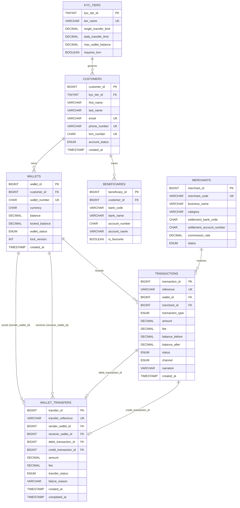

# Portfolio 1: Database Design and Modelling

## 1. Case Study Overview: Oval Pay Finances
**Oval Pay Finances** is a digital wallet and financial transaction platform that enables customers to hold funds in digital wallets, perform peer-to-peer (P2P) transfers, pay merchants, and manage saved beneficiaries under strict regulatory KYC (Know Your Customer) limits.

To prevent data anomalies, balance discrepancies, or duplicate customer records, the core relational database is designed in **MySQL 8.0 (InnoDB engine)** and normalised to **Third Normal Form (3NF)**.

---

## 2. Entity-Relationship Diagram (ERD)

> **Note:** In addition to the Mermaid ERD below, see [`./screenshots/er-diagram.png`](./screenshots/er-diagram.png) for the exported Miro / DBDiagram visual schema diagram.



---

## 3. Relational Schema, Keys, and Integrity Constraints

The relational schema consists of **7 normalized tables** enforced with strict Primary Keys (`PK`), Foreign Keys (`FK`), Unique Keys (`UK`), and Domain/Check Constraints (`CHECK`).

| Table Name | Primary Key (PK) | Foreign Keys (FK) | Unique Constraints (UK) | Business / Domain Check Constraints (`CHECK`) |
| :--- | :--- | :--- | :--- | :--- |
| **`kyc_tiers`** | `kyc_tier_id` | None | `tier_name` | `single_transfer_limit > 0`, `daily_transfer_limit >= single_transfer_limit`, `max_wallet_balance > 0` |
| **`customers`** | `customer_id` | `kyc_tier_id` → `kyc_tiers(kyc_tier_id)` | `email`, `phone_number`, `bvn_number` | `account_status IN ('active', 'suspended', 'closed')` |
| **`wallets`** | `wallet_id` | `customer_id` → `customers(customer_id)` | `wallet_number`, `(customer_id, currency)` | `balance >= 0.00`, `locked_balance >= 0.00` (Prevents negative wallet balances at the DB layer) |
| **`merchants`** | `merchant_id` | None | `merchant_code` | `commission_rate >= 0.0000 AND commission_rate <= 0.2500` |
| **`beneficiaries`** | `beneficiary_id` | `customer_id` → `customers(customer_id)` | `(customer_id, bank_code, account_number)` | Prevents duplicate beneficiary entries for the same customer |
| **`transactions`** | `transaction_id` | `wallet_id` → `wallets(wallet_id)`<br>`merchant_id` → `merchants(merchant_id)` | `reference` | `amount > 0.00`, `fee >= 0.00`, `balance_before >= 0.00`, `balance_after >= 0.00` |
| **`wallet_transfers`** | `transfer_id` | `sender_wallet_id` → `wallets(wallet_id)`<br>`receiver_wallet_id` → `wallets(wallet_id)`<br>`debit_transaction_id` → `transactions(transaction_id)`<br>`credit_transaction_id` → `transactions(transaction_id)` | `transfer_reference`, `debit_transaction_id`, `credit_transaction_id` | `sender_wallet_id <> receiver_wallet_id` (Prevents self-transfer), `amount > 0.00` |

### Why Referential Integrity Uses `ON DELETE RESTRICT`:
In a financial system (and in Laravel fintech applications), deleting a customer or wallet that has historical ledger transactions would corrupt financial audits. Therefore, foreign keys on `wallets`, `transactions`, and `wallet_transfers` enforce `ON DELETE RESTRICT` so historical ledger records can never be orphaned or silently cascade-deleted.

---

## 4. Normalisation Explanation (UNF → 1NF → 2NF → 3NF)

### **Step 0: Unnormalised Form (UNF)**
Initially, a naive flat spreadsheet or unnormalised table (`raw_fintech_records`) might store customer details, KYC limits, multiple saved beneficiaries, and transaction history in a single wide record:

| customer_id | full_name | email | kyc_tier | daily_limit | wallet_no | balance | saved_beneficiaries (Repeating Group) | tx_references_and_amounts (Repeating Group) |
| :--- | :--- | :--- | :--- | :--- | :--- | :--- | :--- | :--- |
| 101 | Adebayo Ogunlesi | bayo@mail.com | Tier 2 | 500,000 | 3091122334 | 85,000 | `GTB:0123456789, Zenith:2098765432` | `TX01:-5000 (MTN), TX02:+20000 (Deposit)` |

**Problems in UNF:**
* Multi-valued attributes (`saved_beneficiaries`, `tx_references_and_amounts`) violate atomicity.
* Impossible to index or query individual transactions or beneficiaries reliably.

---

### **Step 1: First Normal Form (1NF)**
**Rule:** Eliminate repeating groups and ensure every attribute holds **atomic (indivisible)** values, with a unique primary key identifying each row.

* We split `full_name` into atomic `first_name` and `last_name`.
* We extract repeating beneficiaries and repeating transactions into separate rows, creating a composite key `(transaction_id, customer_id)`:

```text
FLAT_LEDGER_1NF (
    transaction_id [PK], customer_id [PK], first_name, last_name, email,
    kyc_tier_name, daily_transfer_limit, max_wallet_balance,
    wallet_number, wallet_balance,
    tx_reference, tx_type, tx_amount, merchant_code, merchant_name, merchant_commission_rate
)
```
**Remaining Problems in 1NF (Partial Dependencies):**
* Customer details (`first_name`, `email`) depend only on `customer_id`, not on `transaction_id`.
* **Insertion Anomaly:** We cannot register a new customer until they perform at least one transaction!
* **Update Anomaly:** Changing a customer's email requires updating thousands of transaction rows.

---

### **Step 2: Second Normal Form (2NF)**
**Rule:** Must be in 1NF, and **every non-key attribute must be fully functionally dependent on the entire primary key** (no partial dependencies).

We decompose the 1NF table into distinct entities where each attribute depends strictly on its entity's single Primary Key:
1. **`customers`** (`customer_id` PK, `first_name`, `last_name`, `email`, `kyc_tier_name`, `daily_transfer_limit`, `max_wallet_balance`)
2. **`wallets`** (`wallet_id` PK, `customer_id` FK, `wallet_number`, `balance`)
3. **`transactions`** (`transaction_id` PK, `wallet_id` FK, `reference`, `amount`, `merchant_code`, `merchant_name`, `merchant_commission_rate`)
4. **`beneficiaries`** (`beneficiary_id` PK, `customer_id` FK, `bank_code`, `account_number`, `account_name`)

**Remaining Problems in 2NF (Transitive Dependencies):**
* In `customers`: `customer_id → kyc_tier_name → (daily_transfer_limit, max_wallet_balance)`. The regulatory limits depend on the **KYC Tier**, not directly on the individual customer! If the Central Bank updates Tier 2's daily limit from ₦500,000 to ₦1,000,000, we would have to update every Tier 2 customer row.
* In `transactions`: `transaction_id → merchant_code → (merchant_name, merchant_commission_rate)`. Merchant attributes depend on the merchant, not the transaction.

---

### **Step 3: Third Normal Form (3NF)**
**Rule:** Must be in 2NF, and **no non-key attribute may be transitively dependent on the primary key** ($A \rightarrow B \rightarrow C$ is eliminated by moving $B \rightarrow C$ into its own table).

1. **Extracting `kyc_tiers`:** We remove `daily_transfer_limit` and `max_wallet_balance` from `customers` and place them in **`kyc_tiers`** (`kyc_tier_id` PK). Now `customers` only stores `kyc_tier_id` (FK).
2. **Extracting `merchants`:** We remove `merchant_name` and `commission_rate` from `transactions` and place them in **`merchants`** (`merchant_id` PK). Now `transactions` only references `merchant_id` (FK).
3. **Preserving Historical Ledger Snapshots (`balance_before`, `balance_after`, `fee`):** Note that `balance_before`, `balance_after`, and `fee` on `transactions` are **point-in-time historical facts** of that specific transaction event, not transitive dependencies on the current wallet balance or current merchant commission rate. Hence, storing them on `transactions` satisfies 3NF while guaranteeing an immutable financial audit trail.

---

## 5. Files in This Directory

| File | Description |
| :--- | :--- |
| [`01_schema_ddl.sql`](./01_schema_ddl.sql) | Complete MySQL 8.0 DDL script creating `ovalpay_db` and all 7 normalised tables with PK, FK, UNIQUE, and CHECK constraints. |
| [`02_seed_sample_data.sql`](./02_seed_sample_data.sql) | Sample seed data for all 7 tables plus verification queries to test constraints and relationships. |
| [`er_diagram_miro_and_dbdiagram.md`](./er_diagram_miro_and_dbdiagram.md) | DBML and Mermaid definitions used to generate the visual ER Diagram in Miro / dbdiagram.io. |

---

## 6. How to Run and Verify

```bash
# 1. Execute the DDL schema script in MySQL 8.0
mysql -u root -p < 01_schema_ddl.sql

# 2. Load the initial sample data and run verification queries
mysql -u root -p ovalpay_db < 02_seed_sample_data.sql
```

