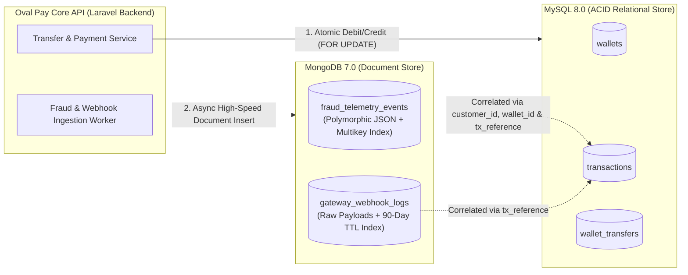

# Portfolio 4: NoSQL and Advanced Data Models

## 1. Overview: Polyglot Persistence in Oval Pay Finances
While **MySQL 8.0** is ideal for **Oval Pay Finances'** core double-entry financial ledger (`wallets`, `transactions`, `wallet_transfers`) where strict ACID transactions and relational integrity are mandatory, a fintech platform also generates high-velocity, semi-structured data that fits poorly into rigid relational tables:

1. **`fraud_telemetry_events` (MongoDB Document Collection):** Every transaction evaluation captures channel-specific telemetry—an iOS mobile transfer logs `biometric_verified`, `battery_level`, and GPS coordinates; a `*810#` USSD session logs `cell_tower_id`, `shortcode_dialed`, and `sim_swap_detected`; a web login logs browser headers and Tor/VPN flags; alongside a variable-length array of `triggered_rules`.
2. **`gateway_webhook_logs` (MongoDB Document Collection):** Third-party payment processors (NIBSS NIP, Paystack, Ikeja Electric Disco) send asynchronous webhook callbacks with deeply nested, provider-specific JSON payloads that change whenever external APIs evolve.

---

## 2. Hybrid Architecture & Document Model (`ovalpay_nosql`)



### **Sample Polymorphic Document (`fraud_telemetry_events`)**
```json
{
  "event_id": "EVT-20261005-0003",
  "customer_id": 5,
  "wallet_id": 5,
  "tx_reference": "OP-TRF-20261005-9999",
  "channel": "web",
  "amount_ngn": 480000.00,
  "device_context": {
    "os": "Linux x86_64",
    "browser": "HeadlessChrome/129.0",
    "device_fingerprint": "dfp_unknown_tor_8821",
    "vpn_or_proxy_detected": true,
    "new_device_login": true
  },
  "network_geo": {
    "ip_address": "185.220.101.45",
    "isp": "Tor Exit Node Network",
    "city": "Frankfurt",
    "country_code": "DE",
    "impossible_travel_detected": true,
    "minutes_since_last_lagos_login": 9
  },
  "risk_assessment": {
    "risk_score": 94,
    "decision": "BLOCK_AND_FREEZE",
    "evaluation_time_ms": 14,
    "triggered_rules": [
      { "rule_code": "IMPOSSIBLE_TRAVEL", "weight": 45, "description": "Login from Germany 9 mins after Lagos session" },
      { "rule_code": "TOR_PROXY_DETECTED", "weight": 30, "description": "Request originated from anonymizing proxy" },
      { "rule_code": "NEW_DEVICE_HIGH_TX", "weight": 25, "description": "Unrecognized device attempting > 250k NGN transfer" }
    ]
  },
  "created_at": "2026-10-05T02:18:30Z"
}
```
Notice how `customer_id: 5` and `wallet_id: 5` link directly to **Tunde Bakare's suspended account and frozen wallet** in our MySQL `customers` and `wallets` tables!

---

## 3. Implementation Evidence & `mongosh` Outputs

### **A. Querying High-Risk Events (`risk_score >= 60`)**
```javascript
db.fraud_telemetry_events.find(
  {
    "risk_assessment.risk_score": { $gte: 60 },
    "risk_assessment.decision": { $in: ["CHALLENGE_2FA", "BLOCK_AND_FREEZE"] }
  },
  { _id: 0, event_id: 1, customer_id: 1, tx_reference: 1, channel: 1, amount_ngn: 1, "risk_assessment.risk_score": 1, "risk_assessment.decision": 1 }
).sort({ "risk_assessment.risk_score": -1 });
```

**Output:**
```json
[
  {
    "event_id": "EVT-20261005-0003",
    "customer_id": 5,
    "tx_reference": "OP-TRF-20261005-9999",
    "channel": "web",
    "amount_ngn": 480000,
    "risk_assessment": {
      "risk_score": 94,
      "decision": "BLOCK_AND_FREEZE"
    }
  },
  {
    "event_id": "EVT-20261006-0004",
    "customer_id": 2,
    "tx_reference": "OP-TRF-20261006-0104",
    "channel": "mobile_app",
    "amount_ngn": 195000,
    "risk_assessment": {
      "risk_score": 65,
      "decision": "CHALLENGE_2FA"
    }
  }
]
```

---

### **B. Multi-Stage Aggregation Pipeline (Risk Exposure by Decision)**
```javascript
db.fraud_telemetry_events.aggregate([
  {
    $group: {
      _id: "$risk_assessment.decision",
      total_events: { $sum: 1 },
      avg_risk_score: { $avg: "$risk_assessment.risk_score" },
      total_amount_exposed_ngn: { $sum: "$amount_ngn" },
      channels_observed: { $addToSet: "$channel" }
    }
  },
  { $sort: { avg_risk_score: -1 } }
]);
```

**Output:**
```json
[
  {
    "_id": "BLOCK_AND_FREEZE",
    "total_events": 1,
    "avg_risk_score": 94.0,
    "total_amount_exposed_ngn": 480000,
    "channels_observed": ["web"]
  },
  {
    "_id": "CHALLENGE_2FA",
    "total_events": 1,
    "avg_risk_score": 65.0,
    "total_amount_exposed_ngn": 195000,
    "channels_observed": ["mobile_app"]
  },
  {
    "_id": "ALLOW",
    "total_events": 2,
    "avg_risk_score": 15.0,
    "total_amount_exposed_ngn": 38000,
    "channels_observed": ["mobile_app", "ussd"]
  }
]
```

---

## 4. Explanation of Suitability: Why MongoDB for Telemetry & Webhooks?

| Evaluation Criteria | Relational Model (MySQL 8.0) | Document Model (MongoDB 7.0) | Suitability Conclusion for Oval Pay Finances |
| :--- | :--- | :--- | :--- |
| **Schema Flexibility (Polymorphic Payloads)** | Poor for heterogeneous payloads: USSD, iOS, POS, NIBSS, and Paystack webhooks have completely different fields, requiring dozens of `NULL` columns or complex EAV tables. | **Excellent:** Native BSON documents store provider-specific and channel-specific nested objects without `ALTER TABLE` migrations. | **MongoDB** is ideal for `fraud_telemetry_events` and `gateway_webhook_logs`. |
| **Read/Write Locality (Embedded Arrays)** | Storing `triggered_rules` in 3NF requires a child `event_triggered_rules` join table and multi-table `INSERT`s on every request. | **Excellent:** Embedding `triggered_rules[]` inside the telemetry document allows single-document atomic writes and fast `$unwind` aggregations. | **MongoDB** eliminates expensive joins for self-contained event logs. |
| **Automated Lifecycle Management (TTL)** | Requires custom scheduled cron jobs (`DELETE FROM webhook_logs WHERE ...`) which cause InnoDB table fragmentation and lock contention. | **Excellent:** Native **TTL Index (`expireAfterSeconds: 7776000`)** automatically purges raw webhook logs older than 90 days in the background. | **MongoDB** drastically simplifies log retention compliance. |
| **Multi-Row Financial Ledger Integrity** | **Superior:** Enforces foreign keys, `CHECK (balance >= 0)`, and multi-wallet locking (`SELECT ... FOR UPDATE`). | Less suited for cross-wallet ledger accounting where relational constraints are critical. | **MySQL 8.0** remains mandatory for `wallets`, `transactions`, and `wallet_transfers`. |

---

## 5. Files in This Directory

| File | Description |
| :--- | :--- |
| [`01_mongodb_setup_and_seed.mongodb.js`](./01_mongodb_setup_and_seed.mongodb.js) | `mongosh` script creating `ovalpay_nosql`, JSON Schema validation rules, Multikey/TTL indexes, and polymorphic seed documents. |
| [`02_mongodb_queries_and_aggregations.mongodb.js`](./02_mongodb_queries_and_aggregations.mongodb.js) | MongoDB queries and multi-stage Aggregation Pipelines (`$group`, `$unwind`, `$project`). |
| [`sample_documents.json`](./sample_documents.json) | Sample BSON/JSON document structure for quick inspection. |
