# Portfolio 5: Distributed and Cloud Database Exercise

## 1. Overview: Scaling Oval Pay Finances in a Distributed Cloud Environment
As **Oval Pay Finances** scales to millions of customers and hundreds of millions of wallet transactions across Nigeria, a single standalone MySQL server becomes both a **Single Point of Failure (SPOF)** and an I/O bottleneck.

This portfolio designs and implements a **Distributed & Cloud Database Architecture** for Oval Pay Finances covering:
1. **Primary-Replica Replication (Read/Write Splitting with GTID & Sticky Sessions)**
2. **Horizontal Partitioning (`PARTITION BY RANGE`) & Distributed Sharding Strategy**
3. **CAP Theorem & PACELC Trade-offs (Consistency vs. Availability in Fintech)**
4. **High Availability, Failover, and Multi-AZ Cloud Deployment Evidence**

---

## 2. Distributed Database Architecture Diagram

```mermaid
flowchart TB
    subgraph Clients["Client Channels"]
        APP["Mobile App (iOS/Android)"]
        USSD["USSD Gateway (*810#)"]
        POS["POS Terminals & Web"]
    end

    subgraph AppTier["Oval Pay Application Tier (Laravel API Cluster)"]
        ROUTER["Read/Write Connection Router\n(sticky = true)"]
    end

    subgraph SQLCluster["Multi-AZ MySQL 8.0 Cluster (CP — Strict Financial Consistency)"]
        PRIMARY[("MySQL Primary Node (AZ-1)\nPort 3306 | GTID Row Binlog\nHandles: Transfers, Debits, FOR UPDATE")]
        STANDBY[("MySQL Sync Standby (AZ-2)\nSemi-Synchronous Failover Target")]
        REPLICA1[("MySQL Read Replica 1 (AZ-2)\nPort 3307 | super_read_only=ON\nHandles: Statements & App Reads")]
        REPLICA2[("MySQL Read Replica 2 (AZ-3)\nHandles: AML & Finance Analytics")]
    end

    subgraph Shards["Horizontal Ledger Partitioning (transactions_partitioned)"]
        P1["Partition p_2026_09"]
        P2["Partition p_2026_10"]
        P3["Partition p_2026_11"]
    end

    subgraph NoSQLCluster["MongoDB Atlas / Replica Set (AP — High Write Availability)"]
        MONGO[("MongoDB Telemetry Cluster\novalpay_nosql (3-Node Replica Set)")]
    end

    Clients --> ROUTER
    ROUTER -->|"WRITE: Wallet Transfers & Locking"| PRIMARY
    ROUTER -->|"READ: Statements & History"| REPLICA1
    ROUTER -->|"READ: Compliance Reports"| REPLICA2
    PRIMARY ==>|"Semi-Sync GTID Replication"| STANDBY
    PRIMARY -.->|"Async GTID Binlog Stream"| REPLICA1
    PRIMARY -.->|"Async GTID Binlog Stream"| REPLICA2
    PRIMARY --- Shards
    ROUTER -.->|"Async Telemetry & Webhooks"| MONGO
```



---

## 3. Replication Strategy: Primary-Replica with GTID

### **How It Works in Oval Pay Finances:**
1. **Write Path (`mysql-primary`):** All state-mutating operations (`sp_execute_p2p_transfer`, wallet deposits, withdrawals, and `SELECT ... FOR UPDATE` locks) execute exclusively on the **Primary Node** configured with `gtid_mode=ON`, `binlog_format=ROW`, and `innodb_flush_log_at_trx_commit=1` (full ACID durability).
2. **Replication Stream:** Committed transactions are written to the binary log with a **Global Transaction Identifier (GTID)** and streamed to **Read Replicas (`mysql-replica-1`, `mysql-replica-2`)** running with `super_read_only=ON`.
3. **Read-Your-Own-Writes Consistency (`sticky => true`):**
   * **Problem:** Asynchronous replication introduces a `10ms–150ms` replication lag. If a customer transfers `₦50,000` on the Primary and the app immediately queries a Read Replica to refresh their dashboard balance, they might briefly see their old balance!
   * **Solution:** As shown in [`laravel_read_write_database_config.php`](./laravel_read_write_database_config.php), configuring `'sticky' => true` ensures that any HTTP request that performs a `WRITE` automatically routes subsequent `READ`s in that same request cycle to the **Primary**, while read-only requests (viewing monthly statements or merchant analytics) hit the **Replicas**.

---

## 4. Sharding & Horizontal Partitioning Strategy

### **A. Implemented Local Time-Series Range Partitioning (`01_partitioning_and_sharding_strategy.sql`)**
Because 95% of customer account statement queries and compliance audits filter on recent dates (`created_at`), we partitioned `transactions_partitioned` using `PARTITION BY RANGE (YEAR(created_at) * 100 + MONTH(created_at))`:

```text
+----------------+------------------+----------------+
| PARTITION_NAME | less_than_yyyymm | estimated_rows |
+----------------+------------------+----------------+
| p_2026_07      |           202608 |          10758 |
| p_2026_08      |           202609 |           8928 |
| p_2026_09      |           202610 |           8640 |
| p_2026_10      |           202611 |           8928 |
| p_2026_11      |           202612 |            145 |
| p_future       | MAXVALUE         |              0 |
+----------------+------------------+----------------+
```

#### **Partition Pruning Verification (`EXPLAIN` Output):**
When querying October 2026 transactions (`WHERE created_at BETWEEN '2026-10-01' AND '2026-10-31'`), MySQL's optimizer prunes all other partitions and scans **only `p_2026_10`**:
```text
+----+-------------+--------------------------+------------+-------+----------------------------+----------------------------+---------+------+------+----------+-----------------------+
| id | select_type | table                    | partitions | type  | possible_keys              | key                        | key_len | ref  | rows | filtered | Extra                 |
+----+-------------+--------------------------+------------+-------+----------------------------+----------------------------+---------+------+------+----------+-----------------------+
|  1 | SIMPLE      | transactions_partitioned | p_2026_10  | range | idx_tx_part_wallet_date    | idx_tx_part_wallet_date    | 14      | NULL |    9 |   100.00 | Using index condition |
+----+-------------+--------------------------+------------+-------+----------------------------+----------------------------+---------+------+------+----------+-----------------------+
```

### **B. Distributed Multi-Node Sharding Design**
When write throughput exceeds a single Primary node's vertical capacity:
* **Shard Key Selection:** `customer_id` (Hash Sharding: `shard_id = customer_id % N_SHARDS`). Co-locating a customer's `wallets` and `transactions` on the same shard ensures single-wallet deposits, withdrawals, and merchant payments execute within a **single shard** without network hops.
* **Cross-Shard P2P Transfers:** When Customer A (on `Shard 1`) transfers to Customer B (on `Shard 2`), the transfer service uses the **Transactional Outbox / Saga Pattern**:
  1. `Shard 1` atomically debits Sender Wallet `#1` and inserts an outbox event `TRANSFER_DEBITED`.
  2. The orchestrator credits Receiver Wallet `#2` on `Shard 2`.
  3. If `Shard 2` rejects the credit (e.g., receiver account frozen), a **Compensating Transaction** automatically credits Wallet `#1` back on `Shard 1` (`transaction_type = 'reversal'`).

---

## 5. CAP Theorem Analysis for Oval Pay Finances

During a network partition ($P$), a distributed data store must choose between **Consistency ($C$)** and **Availability ($A$)**:

| Subsystem | Data Store | CAP Classification | Architectural Justification |
| :--- | :--- | :--- | :--- |
| **Wallet Balances & P2P Transfers** (`wallets`, `transactions`, `wallet_transfers`) | **MySQL 8.0 Cluster** (Semi-Synchronous Primary/Standby) | **CP (Consistency + Partition Tolerance)** | **Strict Consistency is non-negotiable.** If a network split isolates a node, Oval Pay MUST reject or block wallet debits on the isolated partition rather than risk a **Split-Brain double-spend** where a user withdraws the same balance twice across two disconnected nodes. |
| **Customer Read Statements & Analytics** | **MySQL Read Replicas** | **Eventual Consistency (Tunable)** | Viewing a historical PDF statement or merchant dashboard can tolerate a few milliseconds of asynchronous lag in exchange for high read availability. |
| **Fraud Telemetry & Gateway Webhook Ingestion** (`ovalpay_nosql`) | **MongoDB Replica Set** | **AP / High Write Availability** | Webhook callbacks from NIBSS or Paystack must always be accepted and persisted even if a secondary telemetry node is unreachable, ensuring no external payment notification is dropped. |

---

## 6. Files in This Directory

| File | Description |
| :--- | :--- |
| [`docker-compose.replication.yml`](./docker-compose.replication.yml) | Docker Compose setup defining `mysql-primary` (GTID master), `mysql-replica-1` (read-only replica), and `mongodb-telemetry`. |
| [`01_partitioning_and_sharding_strategy.sql`](./01_partitioning_and_sharding_strategy.sql) | SQL implementation of `transactions_partitioned` (`PARTITION BY RANGE`), partition pruning verification, and GTID replication commands. |
| [`laravel_read_write_database_config.php`](./laravel_read_write_database_config.php) | Production Laravel database configuration demonstrating Read/Write splitting with `'sticky' => true`. |
